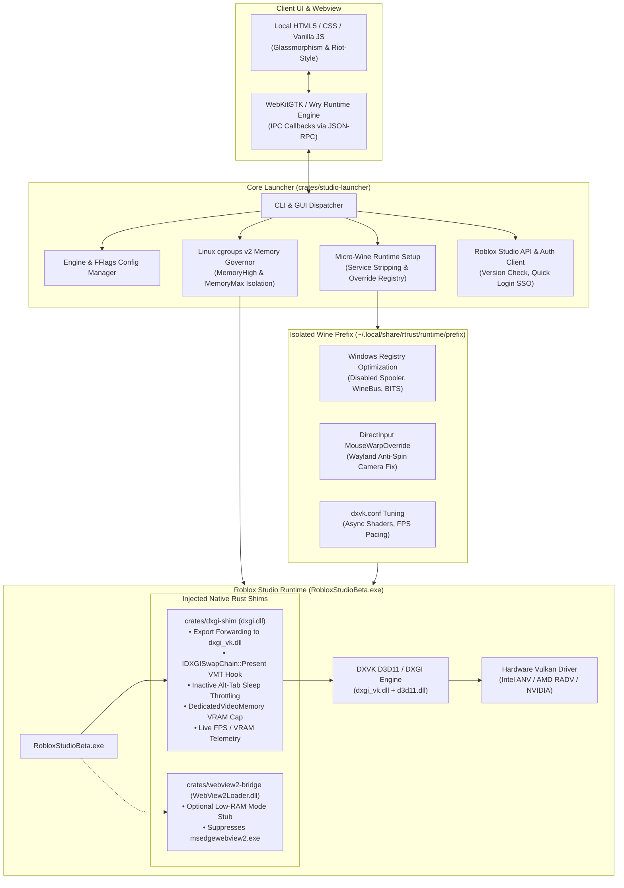

# RtRust Architecture

This document describes the high-level architecture, subsystem interactions, and low-level interception shims in **RtRust** (`RTRUST`).

---

## 1. High-Level Architecture Diagram

---

## 2. Component Breakdown

### A. Client UI Layer (`crates/studio-launcher/ui`)
- **Technology:** WebKitGTK embedded via the Rust `wry` crate.
- **IPC Protocol:** Bidirectional IPC using native JavaScript `window.ipc.postMessage(...)` and Rust-side event loop evaluation.
- **Design:** Dark glassmorphism theme with 60 FPS CSS transitions, hardware status indicators, and responsive tab switching.
- **Tabs & Flow:**
  - **Sign In:** Split-screen layout featuring a Quick Login 6-character code generator with automatic polling and guest/offline bypass.
  - **Settings & Engine Optimizer:** Engine profile presets (`Low-End iGPU`, `Balanced`, `High-Performance`), granular renderer selection (Vulkan DXVK vs D3D11), VRAM cap limits, Wayland anti-spin switches, and custom Fast Flags (FFlags).

---

### B. Core Launcher & Linux Environment Manager (`crates/studio-launcher`)
- **Micro-Wine Runtime (`runtime.rs`):**
  - Maintains an isolated prefix located at `~/.local/share/rtrust/runtime/prefix`.
  - Disables redundant background Wine services in `HKLM\System\CurrentControlSet\Services` (`Spooler`, `WineBus`, `PlugPlay`, `LanmanServer`, `BITS`).
  - Sets DLL overrides (`WINEDLLOVERRIDES="winemenubuilder.exe=d;dxgi=n;d3d11=n"`).
- **Linux cgroups v2 Memory Governor (`cgroups.rs`):**
  - Spawns the Studio process tree inside a dedicated transient systemd user slice (`systemd-run --user --scope`).
  - Configures `MemoryHigh` and `MemoryMax` boundaries to prevent out-of-memory (OOM) freezing on systems with 8GB or 16GB shared RAM.
- **Wayland DirectInput Fix (`runner.rs`):**
  - Enforces `MouseWarpOverride=force` under `HKCU\Software\Wine\DirectInput` to eliminate the infinite 360-degree camera spin glitch on modern Wayland compositors (Hyprland, Sway, KDE Plasma 6, GNOME Wayland).

---

### C. Rust DXGI Proxy Shim (`crates/dxgi-shim`)
Cross-compiled with `x86_64-pc-windows-gnu` into `dxgi.dll` and placed in the active Studio version directory:
1. **Proxy Export Forwarding:**
   Implements all standard DXGI C-ABI exports (`CreateDXGIFactory`, `CreateDXGIFactory1`, `CreateDXGIFactory2`, `DXGID3D10CreateDevice`, `DXGID3D10RegisterLayers`, `DXGIGetDebugInterface1`, `DXGIDeclareAdapterRemovalSupport`, etc.) and dynamically proxies them to DXVK's renamed `dxgi_vk.dll`.
2. **Virtual Method Table (VMT) Hooking:**
   Intercepts `IDXGISwapChain::Present` calls:
   - **Inactive Window GPU Throttling (Alt-Tab Power Saver):** Monitors foreground window state via `GetForegroundWindow()`. When the user switches focus to VS Code or a web browser, the hook injects a 100ms sleep, dropping background GPU usage to near 0%.
   - **Frame Pacing & Telemetry:** Calculates instantaneous FPS and writes live performance metrics to `/tmp/rtrust_gpu_stats.json`.
3. **VRAM Cap Reporting:**
   Intercepts `IDXGIAdapter::GetDesc` and caps `DedicatedVideoMemory` to the user's selected limit (e.g., 1024MB or 2048MB), guiding Roblox's streaming engine to avoid thrashing system memory on integrated graphics.

---

### D. Optional WebView2 Low-RAM Stub (`crates/webview2-bridge`)
- Cross-compiled as `WebView2Loader.dll`.
- Replaces Microsoft's Edge WebView2 loader when Low-RAM Mode is enabled, suppressing background Chromium sub-processes (`msedgewebview2.exe`) and saving 600MB–1.2GB of physical RAM.

---

## 3. Platform Roadmap

| Platform | Status | Runtime Stack |
| :--- | :--- | :--- |
| **Linux (x86_64)** | **Production Ready (v0.0.1)** | Native ELF Launcher + Micro-Wine Prefix + DXVK Vulkan + DXGI Shim |
| **Windows (x86_64)** | **In Active Development** | Standalone PE32+ Binary + Native Roblox Studio Execution + Safe DLL Swap |
