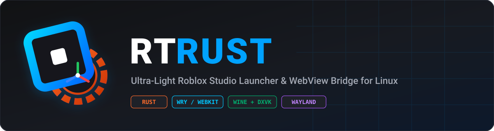

<p align="center">
  
</p>

# RtRust (RTRUST): Ultra-Lightweight Roblox Studio Manager & Launcher

RtRust is a modular, high-performance launcher, runtime governor, and graphics optimizer for **Roblox Studio on Linux**, written in Rust.

> [!NOTE]
> **Platform Status:**
> - 🐧 **Linux (x86_64):** **Ready for Production** (Release v0.0.1 with DXVK Vulkan, Micro-Wine, Wayland Anti-Spin Fix, and Rust DXGI Shim).
> - 🪟 **Windows (x86_64):** **In Active Development** (Native execution, Safe DLL Swap, and single-binary packaging are planned for an upcoming release).

---

## Key Highlights

- **Rust DXGI Proxy Shim (`dxgi-shim`):**
  - **Alt-Tab GPU Power Saver:** Detects when the user switches to other windows (VS Code, browser) and injects sleep into `IDXGISwapChain::Present`, plummeting GPU load to near 0%.
  - **VRAM Cap Reporting:** Clamps `DedicatedVideoMemory` in `IDXGIAdapter::GetDesc` (1024MB / 2048MB) to stop Roblox Studio from over-allocating VRAM on shared iGPUs.
  - **Live GPU Telemetry:** Records real-time frame rates and memory stats to `/tmp/rtrust_gpu_stats.json`.
- **Linux cgroups v2 Memory Governor:**
  - Wraps the Studio runtime inside a transient systemd user slice (`systemd-run --user --scope`) with `MemoryHigh` and `MemoryMax` thresholds, preventing Linux out-of-memory freezing.
- **Slim Micro-Wine Isolated Prefix:**
  - Automatically builds and maintains an isolated prefix at `~/.local/share/rtrust/runtime/prefix`.
  - Strips bloated background Windows services in the registry (`Spooler`, `WineBus`, `PlugPlay`, `LanmanServer`, `BITS`), saving 50-100MB of idle RAM.
- **Wayland Camera Anti-Spin Fix:**
  - Enforces `MouseWarpOverride=force` for Wine DirectInput, eliminating infinite 360-degree camera spin on modern Wayland compositors (Hyprland, Sway, KDE Plasma, GNOME).
- **Modern Riot-Inspired Dark WebUI:**
  - Hardware-accelerated local interface built with WebKitGTK and Wry.
  - Fast Quick Login SSO code polling and offline/guest bypass.
  - Real-time engine preset switcher: **Low-End iGPU**, **Balanced**, and **High-Performance**.

---

## Performance Benchmarks

<p align="center">
  
</p>

---

## Distro Compatibility & Requirements

| Linux Distribution | Compatibility | Installation Method | Notes |
| :--- | :---: | :--- | :--- |
| **Arch Linux / Manjaro / EndeavourOS** | 🟢 Native | Pre-built binary or AUR (`rtrust-bin`) | Supported out of the box |
| **Fedora 40 / 41 / Rawhide** | 🟢 Native | Pre-built binary (`glibc >= 2.39`) | Supported out of the box |
| **Ubuntu 24.04+ LTS / Pop!_OS 24.04** | 🟢 Native | Pre-built binary (`glibc >= 2.39`) | Supported out of the box |
| **Debian 12 (Bookworm)** | 🟡 Source Build | `cargo build --release` | System glibc is 2.36; build from source |
| **Ubuntu 22.04 LTS** | 🟡 Source Build | `cargo build --release` | System glibc is 2.35; build from source |
| **Windows 10 / 11** | ⏳ In Development | Single .exe binary coming soon | Win32 native target planned |

---

## Architecture Overview

```
[ WebKitGTK / Wry Local WebUI ]
             │
             ▼ (JSON-RPC IPC)
[ RtRust Core Launcher (crates/studio-launcher) ]
   ├── cgroups v2 Memory Governor
   ├── Micro-Wine Prefix Manager & Service Stripper
   └── Wayland DirectInput MouseWarp Configurator
             │
             ▼
[ Roblox Studio Process (RobloxStudioBeta.exe) ]
   ├── Injected Rust DXGI Proxy Shim (dxgi.dll) ──► Alt-Tab GPU Throttling & VRAM Clamp
   └── DXVK Vulkan Translation Engine (dxgi_vk.dll + d3d11.dll) ──► Vulkan Driver
```

For full architecture specifications, see [ARCHITECTURE.md](ARCHITECTURE.md).

---

## Installation & Usage (Linux)

### 1. Download Pre-Built Binary
Grab the standalone Linux executable from the [GitHub Releases](https://github.com/4sakenme/RtRust/releases):
```bash
chmod +x rtrust
./rtrust
```

### 2. Building from Source
Ensure you have the Rust toolchain and required GTK/WebKit development libraries installed:

```bash
# Ubuntu / Debian
sudo apt install libwebkit2gtk-4.1-dev libgtk-3-dev build-essential

# Arch Linux
sudo pacman -S webkit2gtk-4.1 gtk3 base-devel
```

Build the release binary:
```bash
cargo build --release -p studio-launcher
cp target/release/studio-launcher dist/rtrust
```

Run the launcher:
```bash
./dist/rtrust
```

---

## CLI & Diagnostic Commands

```bash
# Launch with hardware auto-detection (default 60 FPS cap)
./dist/rtrust run

# Run environment diagnostics (doctor)
./dist/rtrust doctor

# Check for and fetch the latest Studio version without opening GUI
./dist/rtrust update
```

---

## License

This project is licensed under the MIT License. See [LICENSE](LICENSE) for details.
