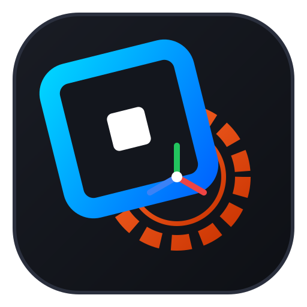

<p align="center">
  
</p>

<h1 align="center">RtRustMobile (v0.5.1)</h1>

<p align="center">
  <strong>Native iOS, Android, Waydroid &amp; Desktop Roblox Studio Editor &amp; Runtime in Rust</strong>
</p>

<p align="center">
  <a href="https://github.com/4sakenme/RtRust/releases"></a>
  <a href="https://github.com/rippelz/rustudio"></a>
  
  
</p>

---

## What is RtRustMobile?

**RtRustMobile** is the mobile (**iOS** & **Android**) and ultra-low-end edition of **[RtRust](https://github.com/4sakenme/RtRust)**, powered by the native Rust **[rustudio](https://github.com/rippelz/rustudio)** engine (no Wine, no JVM simulation).

- **Native Luau VM (`--!native` codegen)**, **Rapier3D & Studio physics**, **R6/R15 character simulation**, **`wgpu` (Metal / Vulkan)** rendering, incremental voxel lighting, Team Create live sync, Rojo/Argon File Sync, MicroProfiler, and built-in MCP server.
- **v0.5.1 Highlights:** Progressive frame-budgeted streaming (`≤ 4ms`/frame) for large places (e.g., *Crimson Fear*), Stitch-designed Obsidian Studio UI, animated `rtrust.svg` Loading Screen, **Focus Code IDE** mode (zero-3D coding), draggable 3-side **Explorer**, vertically resizable **Output**, and long-press **Part Actions (Clone/Duplicate)** in the 3D Viewport.

---

## Memory & Performance Architecture (iOS Jetsam & Low-RAM Devices)

Large places with hundreds of `MeshPart`s and high-resolution textures can easily exceed iOS's **2098 MB ActiveHard Jetsam limit** on 4 GB devices (like iPhone 11 Pro) if assets burst-decode on load. `RtRustMobile v0.5.1` solves this with 6 coordinated layers:

1. **Immediate CPU Buffer Drop (`crates/rustudio-core/src/assets.rs`):**
   - Raw decoded pixel `Vec<u8>` and vertex/normal/UV buffers are dropped immediately after `wgpu::Texture` / `wgpu::Buffer` upload, and compressed `AssetStore::memory` bytes are evicted right after GPU upload on mobile.
2. **AssetId `Weak`/`Arc` Deduplication (`MeshCache` & `TextureCache`):**
   - Repeated `MeshPart`s and decals sharing the same numeric `AssetId` share a single GPU allocation via `HashMap<u64, Weak<LoadedMesh / LoadedTexture>>`.
3. **Progressive Frame-Budgeted Streaming (`≤ 4ms` & Max 2 Assets/Frame):**
   - Prevents burst decoding on place load or Playtest start by capping decode + GPU upload to **at most 2 assets per frame** within a **4.0 ms** frame budget.
4. **Spatial Ring Priority (`0–250 studs` Load, `> 350 studs` Unload):**
   - `crates/rustudio-player/src/game_view.rs` sorts pending parts by distance to the camera (`0–120 studs` first), defers distant parts (`> 250 studs`) as lightweight colored boxes until approached, and unloads draw items beyond `350 studs`.
5. **Staggered Playtest Boot (`Max 3 Scripts/Frame`) & Lazy Audio:**
   - `crates/rustudio-player/src/play.rs` boots `Script` / `LocalScript` instances gradually (`3` per frame) instead of freezing on frame 1.
   - `crates/rustudio-engine/src/domains/media.rs` skips pre-decoding `.ogg`/`.mp3` audio into raw PCM on iOS until `.Play()` is called.
6. **iOS Texture Cap, `160 MB` LRU Cache & `didReceiveMemoryWarning` Hook:**
   - `crates/rustudio-core/src/texture.rs` downscales iOS textures to **`512×512`** (`256×256` in **Eco** mode) without cloning the full pixel buffer.
   - `AssetStore::memory` enforces a strict **`160 MB` (iOS) / `200 MB` (Android)** LRU cap.
   - `src/platform.rs` observes `UIApplicationDidReceiveMemoryWarningNotification` to immediately pause outer-ring streaming (`120 studs` for 3s), purge unused caches, and trigger `lua.gc_collect()`.

---

## UI / UX Architecture (iOS, Android & Desktop)

- **Animated `rtrust.svg` Loading Screen (`src/loading_screen.rs`):** Clean solid `#0B0D12` Obsidian canvas with rotating Rust-orange gear, breathing cyan Studio cube, 3D gizmo axes, backend badge (`Metal · 64-bit` / `Vulkan · 64-bit`), and frosted-glass progress pill.
- **Stitch Obsidian Start Page (`src/start_page.rs`):** Clean dark `#111318` surface with `+ New Baseplate`, `</> Focus Code IDE`, `Open .rbxl File`, and `Studio Settings`.
- **Focus Code IDE Mode (`src/studio_ribbon.rs`):** Pure code-editing workspace (`viewport_hidden = true`) that skips 3D scene rendering to save battery and RAM.
- **Draggable 3-Side Explorer + Corner Resize:** Long-press & drag `≡ Explorer` to preview a translucent ghost and snap to **Left**, **Right**, or **Bottom** dock zones, plus a **`◢`** corner grip for instant resizing.
- **Vertically Resizable Output Drawer:** Full-width drag handle bar (`↕`) on the Output panel across Desktop, Landscape Mobile, and Focus Code IDE.
- **Long-Press Part Actions (`src/viewport_menu.rs`):** Long-press (`≥ 0.48s`) any Part in the 3D Viewport to open a quick action card (`Duplicate (Clone)`, `Copy`, `Paste`, `Focus`, `Group`, `Delete`).

---

## Performance Benchmarks

Measured with `--play --headless --no-ui --bench --seconds 3`:

| Place / Tier | Environment Config | Frames (3s) | Avg FPS | 1% Low FPS | Avg Frame | Work / CPU | Draw Calls |
|---|---|---:|---:|---:|---:|---:|---:|
| **Demo — Ultra-Low** | `LOWEND=1`, `PLAY_WORKER=0`, `2T` | **459** | **152.9 FPS** | **96.2 FPS** | **6.54 ms** | **1.40 / 2.26 ms** | **20** |
| **Demo — Low-End** | `LOWEND=1`, `PLAY_WORKER=1`, `4T` | **433** | **144.0 FPS** | **83.7 FPS** | **6.95 ms** | **1.83 / 2.89 ms** | **20** |
| **Demo — Balanced** | `LOWEND=0`, `PLAY_WORKER=1`, `4T` | **101** | **33.4 FPS** | **25.8 FPS** | **29.94 ms** | **2.12 / 3.17 ms** | **35** |
| **Demo — High** | `LOWEND=0`, `PLAY_WORKER=1`, `All` | **94** | **31.2 FPS** | **20.5 FPS** | **32.02 ms** | **2.45 / 3.65 ms** | **35** |
| **`aaaa.rbxl` — Ultra-Low** | `LOWEND=1`, `PLAY_WORKER=0`, `2T` | **1795** | — | — | — | — | **18** |
| **`aaaa.rbxl` — High** | `LOWEND=0`, `PLAY_WORKER=1`, `All` | **1621** | — | — | — | — | **18** |

---

## Build from Source

```bash
# Desktop (Linux / macOS / Windows)
cargo build --release

# Android APK (arm64-v8a)
cargo ndk -t arm64-v8a --platform 26 -o android/jniLibs build --release --lib
gradle -p android assembleDebug
```

---

## Credits & License

- **Upstream Engine:** Built on **[rippelz/rustudio](https://github.com/rippelz/rustudio)**.
- **Disclaimer:** Independent open-source project; not affiliated with or endorsed by Roblox Corporation.
- **License:** `MIT OR Apache-2.0` (vendored crates in `vendor/` keep their respective licenses).
